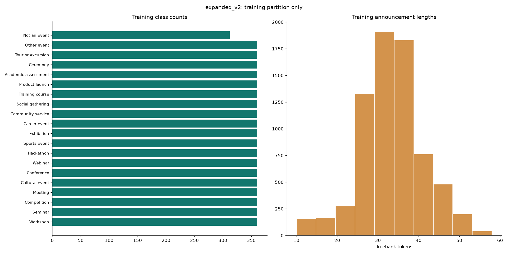
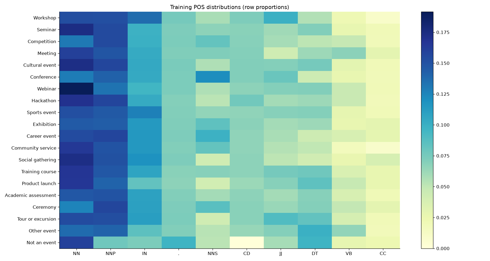

# Event Announcement Understanding Using a Hybrid NLP Approach

Version 2 course AAT report draft. Student names, identifiers, guide details, signatures, certificates and declarations remain for genuine human completion.

## 1. Problem statement

The application recognizes event categories and extracts name, date, time and venue from English announcements while preserving exact source evidence. Version 1 had five categories, 80 synthetic development records and narrow phrase rules. Its keyword gate could veto the learned classifier and reject unfamiliar sentences. The revised system targets invitations, paragraphs, informal plans, notices and labelled details with a broader taxonomy and learned span extraction. Arbitrary language is not guaranteed to be understood.

The user authorized broader categories, substantial synthetic data, revised extraction and a quieter interface. Missing or ambiguous details are now communicated beside their fields. Repeated synthetic-training banners were removed from the main flow; provenance remains in data, methodology, evaluation and exports.

## 2. Design approach

### 2.1 Categories and overlap

| Category | Definition |
|---|---|
| Workshop | A short, participatory session focused on practical exercises. |
| Seminar | A speaker-led lecture, research talk or discussion. |
| Competition | A judged contest with ranked entries or winners; excludes explicitly named hackathons and sports fixtures. |
| Meeting | An organizational, planning, committee or team discussion. |
| Cultural event | An arts performance, concert, dance, theatre or cultural festival. |
| Conference | A formal conference, convention, summit or multi-session research gathering. |
| Webinar | An explicitly described online presentation or webinar; an online practical workshop remains Workshop. |
| Hackathon | A time-bounded collaborative coding or prototype-building contest. |
| Sports event | An athletic fixture, race, tournament or organized fitness event. |
| Exhibition | A public display, gallery, expo or showcase of objects or work. |
| Career event | Recruitment, placement, career fair, networking for jobs or employer interaction. |
| Community service | Volunteering, charity, community outreach, donation or environmental service. |
| Social gathering | A party, reunion, picnic, informal celebration or social get-together. |
| Training course | A structured multi-session course, certification programme or sustained professional training. |
| Product launch | The introduction, unveiling or release event of a product or service. |
| Academic assessment | An examination, viva, assessment, defense or evaluation session. |
| Ceremony | Graduation, inauguration, felicitation, awards presentation or other formal ceremony. |
| Tour or excursion | An organized visit, field trip, excursion, guided walk or tour. |
| Other event | A specific organized happening whose purpose does not fit the categories above. |

An internal **Not an event** label supports rejection of general discussion. Primary format is interpreted in event context: a workshop about careers remains Workshop, a recruitment drive with a talk remains Career event, and “Seminar Room” is a venue rather than a seminar cue. Specific hackathons and sporting fixtures have their own categories. Delivery platforms are not themselves category evidence. Explicit format interpretation is recorded separately from the statistical prediction so the final system is distinguishable from standalone classifier scores.

### 2.2 Substantive NLTK and supervised learning

NLTK English Punkt segments sentences; Treebank token spans retain original characters; Penn POS tags support candidate RegexpParser grammars and supervised sequence features. Classification-only preprocessing uses POS-aware WordNet lemmatization and stopword filtering without modifying extraction text. NLTK NaiveBayesClassifier is trained on 1,500 train-derived binary lemma features. FreqDist, collocations, POS distributions and representative chunks support training-only corpus analysis.

Raw and lemmatized TF-IDF word unigram/bigram logistic pipelines are compared on identical partitions. A further word/character 3–5-gram pipeline supports surface-form variation. The default is the best validation LR variant; Naive Bayes is also available and may outperform it on this authored corpus. Naive Bayes remains a strong measured alternative. Different representations make the NB-versus-LR comparison less controlled than raw-versus-lemmatized LR.

A conditional random field (CRF) is actually trained on **4000** train-only BIO-labelled announcements. Features include NLTK POS, word shape, casing, suffixes and a two-token context in each direction [1]. It proposes event-name and venue spans; context and evidence rules select them. Explicit title/venue labels and quoted titles outrank weak phrase candidates. This extends the original rules-plus-chunking approach without a transformer, GPU or external inference.

### 2.3 Data and reproducibility

The expanded corpus contains **11,922** explicitly synthetic records: 600 per event category plus deduplicated negative examples. All have authored expected labels/spans and no invented human review. The real pilot remains separate at **26** retained candidates and **0** accepted human reviews.

Actual split sizes are **{'train': 7152, 'test': 2384, 'validation': 2386}**, across **70** construction groups, with recorded group and normalized-exact-duplicate overlap zero. Known template variants, untitled constructions and negative constructions stay within one partition. Proper-name and venue-prefix pools are partitioned; standard platforms and category vocabulary necessarily recur. Title themes and purpose descriptions also recur, so this is not a test of wholly unseen topics or independent natural data.

Vocabulary and IDF fit only on train. Both LR settings C=1 and C=4 are selected on validation macro F1. NB feature selection uses train only. CRF uses a deterministic 4,000-record train subset. Source/model hashes, assignments, library versions, features and actual selection are saved. The final test is evaluated explicitly after freezing; its errors are recorded without subsequent tuning. Original version-1 results/challenges remain preserved and were not used as a new tuning set.

Synthetic construction randomizes field absence, sentence order, formats, case, deadlines and address distractors. Some location/type combinations are intentionally difficult or implausible. Authored descriptions and repeated themes make the task easier than independent real-world data. Group/exact audits do not prove that every paraphrase has been detected. Human review and independently sourced evaluation remain necessary for academic claims about real-data generalization.

## 3. System requirements

Python 3.13.3, NLTK, scikit-learn, sklearn-crfsuite/python-crfsuite, FastAPI, React and Vite. CPU only. Full dependency locks and project-local NLTK setup are provided. No database, authentication, paid API, GPU, external LLM inference or transformer is required.

## 4. Implementation and evaluation

### 4.1 Recognition and field handling

The application combines model predictions with explicit primary-format context rather than making keyword ties a prerequisite for inference. Rules recognize date/time formats, deadline roles, relative dates, ranges and location contexts. NLTK/CRF provide additional name and venue candidates. Exact spans always address the original input.

Relative dates require a reference date; missing years are not invented. Explicit ranges such as “3–5 November 2028” normalize as an ISO interval using only month/year stated inside that range. Bare hours retain raw text with an AM/PM note. Weekdays adjacent to an absolute date act as modifiers rather than competing dates. Organizer addresses are excluded. Multiple conflicting values remain editable with field notices. Clearly multiple-event text still requires separate analysis rather than pretending there is one correct date/venue.

Missing values are null and receive an inline intimation. General text and multiple events retain necessary global notices. Model provenance is recorded in evaluation/methodology/export metadata. Edited exports invalidate stale evidence/normalization and separately preserve automatic suggestions. API schemas validate response shapes; empty input, backend errors, missing models/resources and a client timeout are handled explicitly.

### 4.2 Classification

All results below are **synthetic benchmark measurements**, not human-reviewed real-data accuracy.

| Partition | Model | n | Accuracy | Macro P | Macro R | Macro F1 |
|---|---|---|---|---|---|---|
| validation | majority | 2386 | 0.0503 | 0.0025 | 0.0500 | 0.0048 |
| validation | keywords | 2386 | 0.7330 | 0.8918 | 0.7288 | 0.7868 |
| validation | nltk_nb | 2386 | 1.0000 | 1.0000 | 1.0000 | 1.0000 |
| validation | logistic_raw | 2386 | 0.9573 | 0.9597 | 0.9519 | 0.9329 |
| validation | logistic_preprocessed | 2386 | 0.9564 | 0.9590 | 0.9509 | 0.9308 |
| validation | logistic_word_char | 2386 | 0.9686 | 0.9700 | 0.9646 | 0.9573 |
| held-out test | majority | 2384 | 0.0503 | 0.0025 | 0.0500 | 0.0048 |
| held-out test | keywords | 2384 | 0.6925 | 0.8778 | 0.6879 | 0.7518 |
| held-out test | nltk_nb | 2384 | 0.9958 | 0.9959 | 0.9952 | 0.9954 |
| held-out test | logistic_raw | 2384 | 0.9723 | 0.9736 | 0.9683 | 0.9633 |
| held-out test | logistic_preprocessed | 2384 | 0.9778 | 0.9787 | 0.9745 | 0.9721 |
| held-out test | logistic_word_char | 2384 | 0.9857 | 0.9862 | 0.9837 | 0.9832 |
| held-out test | hybrid_context | 2384 | 0.9782 | 0.9801 | 0.9783 | 0.9780 |

The end-to-end hybrid-context row, when available, includes explicit-format and non-event interpretation; it must not be presented as the standalone statistical classifier. Per-class supports, full confusion matrices and errors are saved. Character features and lemmatization are not assumed to improve performance; compare measured rows. Very high NB scores reflect easy recurring authored lexical signals and do not demonstrate general deployment reliability.

### 4.3 Controlled extraction

Rules and hybrid use identical held-out inputs, category interpretation and normalization. Hybrid adds NLTK chunk and trained CRF candidates. Wrong present values count as both FP and FN when gold exists; absent/absent is correct absence, not TP. Complete-record accuracy requires all four fields. Metrics include absent examples, so present-gold supports are reported. See METRICS.md.

### Validation extraction (2386 authored examples)

| Method | Field | P | R | F1 | Exact | Gold present |
|---|---|---|---|---|---|---|
| rules | event_name | 0.8753 | 0.8996 | 0.8873 | 0.8630 | 1873 |
| rules | date | 1.0000 | 0.9937 | 0.9968 | 0.9950 | 1891 |
| rules | time | 1.0000 | 0.9925 | 0.9963 | 0.9946 | 1740 |
| rules | venue | 0.9972 | 0.9826 | 0.9898 | 0.9845 | 1834 |
| hybrid | event_name | 0.8875 | 0.9178 | 0.9024 | 0.8772 | 1873 |
| hybrid | date | 1.0000 | 0.9937 | 0.9968 | 0.9950 | 1891 |
| hybrid | time | 1.0000 | 0.9925 | 0.9963 | 0.9946 | 1740 |
| hybrid | venue | 0.9972 | 0.9826 | 0.9898 | 0.9845 | 1834 |

Complete-record accuracy: rules **0.8529**, hybrid **0.8671**.
### Test extraction (2384 authored examples)

| Method | Field | P | R | F1 | Exact | Gold present |
|---|---|---|---|---|---|---|
| rules | event_name | 0.6654 | 0.5469 | 0.6004 | 0.5554 | 1960 |
| rules | date | 1.0000 | 0.9881 | 0.9940 | 0.9904 | 1939 |
| rules | time | 1.0000 | 0.9899 | 0.9949 | 0.9924 | 1785 |
| rules | venue | 0.9681 | 0.9403 | 0.9540 | 0.9312 | 1809 |
| hybrid | event_name | 0.7359 | 0.6071 | 0.6654 | 0.6049 | 1960 |
| hybrid | date | 1.0000 | 0.9881 | 0.9940 | 0.9904 | 1939 |
| hybrid | time | 1.0000 | 0.9899 | 0.9949 | 0.9924 | 1785 |
| hybrid | venue | 0.9637 | 0.9403 | 0.9519 | 0.9279 | 1809 |

Complete-record accuracy: rules **0.5227**, hybrid **0.5638**.

### 4.4 Training-only corpus analysis

Training corpus: 7152 records, 238424 raw tokens / 2297 types; after classification preprocessing 125021 tokens / 622 types.

Frequent/distinctive words, sentence-local PMI collocations with minimum frequency 2, POS distributions, candidate patterns, exact representative chunk spans and interpretations are in reports/expanded_v2/corpus. Recurring type descriptions can dominate features; chunk counts are not proof of extraction quality.

### 4.5 Actual errors and limits

The word/character classifier correctly rejects 70 of 104 synthetic non-event inputs (recall 0.6731); 34 are falsely assigned event categories. Training course receives 6, Academic assessment 4, and Community service, Social gathering and Product launch 3 each. Shared event vocabulary can trigger false positives in general discussion. Aggregate macro F1 obscures this rejection weakness; a mixed real-data test needs genuine non-event controls.

### Actual validation errors

| Method | ID | Field | Expected | Predicted | Input excerpt |
|---|---|---|---|---|---|
| rules | v2-00-49-000 | event_name | harbour creative electronics | None | registration closes on 2 january 2027. announcing the interactive tutorial harbour creative electronics scheduled for 09 dec 2028 at 11:30. participants will build something themse |
| rules | v2-00-49-008 | event_name | coral data storytelling | None | announcing the guided practical session coral data storytelling scheduled for august 31, 2029 at amber community centre. bring a laptop for guided exercises and individual practice |
| rules | v2-01-13-002 | event_name | Coral Modern Biology | None | The department announces "Coral Modern Biology", a seminar on 08 April 2029 at 9:30 PM at Linden Atrium. Listen to a researcher explain recent discoveries, followed by discussion. |
| rules | v2-01-13-006 | event_name | Amber Modern Biology | None | The department announces "Amber Modern Biology", a seminar inside Room 185, Amber Block on January 01, 2027 at 9:45 PM. Listen to a researcher explain recent discoveries, followed  |
| rules | v2-01-13-008 | event_name | linden urban futures | None | the department announces "linden urban futures", a research talk this saturday at 19:30 inside room 161, linden block. listen to a researcher explain recent discoveries, followed b |
| rules | v2-01-44-003 | event_name | Harbour Urban Futures | None | Our scholarly discussion will be Harbour Urban Futures via Google Meet next Friday at 16:30. Listen to a researcher explain recent discoveries, followed by discussion. |
| rules | v2-01-44-010 | event_name | Copper Quantum Horizons | None | Our research talk will be Copper Quantum Horizons on May 01, 2027 at 3:00 PM inside Harbour Cafe. Listen to a researcher explain recent discoveries, followed by discussion. |
| rules | v2-01-49-000 | event_name | amber research methods | None | registration closes on 2 january 2027. announcing the guest lecture amber research methods scheduled for 01 sep 2029 at 5:45 pm. an invited speaker will present findings and answer |
| rules | v2-01-49-002 | event_name | Sapphire Ocean Science | None | Announcing the guest lecture Sapphire Ocean Science at 10:30 at Amber Sports Ground. Listen to a researcher explain recent discoveries, followed by discussion. |
| rules | v2-01-49-006 | event_name | Sapphire Quantum Horizons | None | Announcing the seminar Sapphire Quantum Horizons in Harbour Stadium in 3 days. Listen to a researcher explain recent discoveries, followed by discussion. |
| rules | v2-01-49-009 | event_name | Copper Research Methods | None | Announcing the research talk Copper Research Methods at 9 am. Listen to a researcher explain recent discoveries, followed by discussion. |
| rules | v2-01-49-011 | event_name | Copper Ocean Science | None | Announcing the seminar Copper Ocean Science on 30 June 2027 inside Sapphire Hall. Listen to a researcher explain recent discoveries, followed by discussion. The organizer's office  |
### Actual test errors

| Method | ID | Field | Expected | Predicted | Input excerpt |
|---|---|---|---|---|---|
| rules | v2-00-01-002 | event_name | None | Notice for attendees: a guided practical session | Notice for attendees: a guided practical session will be held today at 9 pm. Participants will build something themselves with help from an instructor. |
| rules | v2-00-01-004 | event_name | None | Notice for attendees: a guided practical session | Notice for attendees: a guided practical session will be held in Willow Meeting Room. Participants will build something themselves with help from an instructor. |
| rules | v2-00-01-011 | event_name | None | Notice for attendees: an interactive tutorial | Notice for attendees: an interactive tutorial will be held on June 15, 2027 at 10:15 AM at Juniper Cafe. Participants will build something themselves with help from an instructor.  |
| rules | v2-00-05-008 | event_name | None | notice for attendees: a guided practical session | notice for attendees: a guided practical session will be held today at 12:45 pm in crimson meeting room. work through practical activities in small groups. |
| rules | v2-00-05-010 | event_name | None | Notice for attendees: a skill-building session | Notice for attendees: a skill-building session will be held on 06 January at 13:30 inside Crimson Garden. Bring a laptop for guided exercises and individual practice. |
| rules | v2-00-06-003 | event_name | Crimson Robotics Lab | None | Please attend the interactive tutorial on Crimson Robotics Lab via Zoom this Saturday at 12:30. Work through practical activities in small groups. |
| rules | v2-00-06-007 | event_name | Crimson Watercolour Basics | None | Registration closes on 2 January 2027. Please attend the interactive tutorial on Crimson Watercolour Basics on 2029-06-09 at 8 am at Room 462, Crimson Block. Bring a laptop for gui |
| rules | v2-00-06-009 | event_name | Willow Watercolour Basics | None | Please attend the hands-on lab on Willow Watercolour Basics. Bring a laptop for guided exercises and individual practice. |
| rules | v2-00-07-000 | event_name | cypress python essentials | None | registration closes on 2 january 2027. cypress python essentials a skill-building session. date: october 22, 2028 time: 12:30 venue: willow atrium work through practical activities |
| rules | v2-00-07-001 | event_name | Willow Design Thinking | None | Willow Design Thinking A skill-building session. Date: 22 November Time: 8 am Venue: Crimson Garden Work through practical activities in small groups. |
| rules | v2-00-07-002 | event_name | Crimson Data Storytelling | None | Crimson Data Storytelling A guided practical session. Date: tomorrow Time: 14:30 Venue: Cypress Studio Participants will build something themselves with help from an instructor. |
| rules | v2-00-07-003 | event_name | Meadow Creative Electronics | None | Meadow Creative Electronics A guided practical session. Date: 13 August 2029 Time: 09:30 Venue: Ivory Atrium Work through practical activities in small groups. |

All per-record predictions, candidates, warnings and evidence are retained for debugging. Remaining weaknesses include title boundaries in unusual constructions, unfamiliar generic venues, complicated discourse, open-set categories, ambiguous dates and domain shift. The application provides useful partial fields and notices rather than fabricating missing details. 

### 4.6 Software verification

The expanded regression suite covers every new category, informal/short sentences, explicit-format versus venue distractors, exact spans, calendars, missing/ambiguous fields, data splits, actual trained artifacts, API validation/failures and export corrections. Browser checks cover the revised main flow and responsive layouts. Actual executed checks are in VERIFICATION.md.

Local warm HTTP benchmark: median 41.0 ms, p95 48.4 ms across 60 short requests; this excludes browser rendering and is not a hardware-independent guarantee.

## 5. Conclusion

The experiments show that event categorization and field extraction have different failure modes.
Recurring lexical cues make category prediction comparatively easy on the authored corpus: the
word/character classifier obtains 0.9832 macro F1, while Naive Bayes obtains 0.9954. In contrast,
event-name boundaries remain difficult, with hybrid strict name F1 of 0.6654. A high category
score therefore provides little assurance that all extracted fields are correct.

The main design insight is to match each NLP component to the structure of its task. Shared
rules already handle explicit dates and clocks effectively. Adding NLTK chunks and a trained
sequence model improves title F1 from 0.6004 to 0.6654 and complete-record accuracy from 0.5227
to 0.5638, while venue F1 decreases slightly. Hybrid processing is useful when additional
candidates are checked against context and exact evidence, rather than accepted automatically.
The 0.6731 non-event recall also shows why per-class error analysis is necessary alongside macro F1.

The resulting local application makes these distinctions visible through source spans, conservative
normalization, field notices and editable exports. The next empirical step is a separately reported,
human-labelled natural-announcement evaluation using the frozen models.

### 5.1 Possible future extensions

Future experiments can use independently annotated departmental notices, club invitations and
consented messaging examples, with agreement measured between two annotators and disagreements
adjudicated before scoring. Adding genuine non-event controls will test the rejection boundary.
A new version can study richer title-boundary supervision and an NLTK-only ablation to separate
chunking benefits from CRF benefits. Source-diverse sampling, category coverage and unseen-template
evaluation should guide further collection. Each new development cycle should reserve a fresh
hold-out partition before model or rule selection.

## References

1. sklearn-crfsuite, supervised sequence tagging tutorial and feature construction. https://sklearn-crfsuite.readthedocs.io/en/latest/tutorial.html
2. Bird, Klein and Loper, Natural Language Processing with Python, chapters 5–7. https://www.nltk.org/book/ch05.html ; https://www.nltk.org/book/ch06.html ; https://www.nltk.org/book/ch07.html
3. scikit-learn, text feature extraction and leakage prevention. https://scikit-learn.org/stable/modules/feature_extraction.html ; https://scikit-learn.org/stable/common_pitfalls.html
4. Original announcement URLs and retrieval records: data/real.jsonl and data/source_log.jsonl.
5. Supplied course PDFs remain unchanged. Automated assistance and human review record: ASSISTANCE_AND_REVIEW.md.

## Separate real-data evaluation

Public-source candidates are awaiting blind manual annotation. Human-reviewed accepted n =59. Results are summarized below. Results will be reported separately using frozen models, with source and class supports.

Project repository: https://github.com/Prathith-Rao/event-announcement-understanding

# Frozen model evaluation on reviewed real text

59 accepted;19 unresolved;4 excluded. One human reviewer, source spans validated. No fitting/tuning.

|Model|Accuracy|Macro F1 (12 supported labels)|Macro F1 (fixed 20)|
|---|---:|---:|---:|
|majority|0.1864|0.0262|0.0157|
|keywords|0.5424|0.4984|0.2991|
|nltk_nb|0.2034|0.2844|0.1707|
|logistic_raw|0.4237|0.3762|0.2257|
|logistic_preprocessed|0.3729|0.3988|0.2393|
|logistic_word_char|0.4746|0.4037|0.2422|
|hybrid_context|0.5424|0.4770|0.2862|

34 newly collected post-freeze accepted records are reported separately in metrics.json; the other25 are earlier pilot records.

Rules and hybrid complete-record accuracy:0.3559. Field F1:name0.2353,date0.3529,time0.8000,venue0.3077. Present supports:29,8,3,12. Two negative examples:default/hybrid non-event recall0.

No inter-annotator agreement or population-level generalization claim; source clusters and limited coverage constrain interpretation.